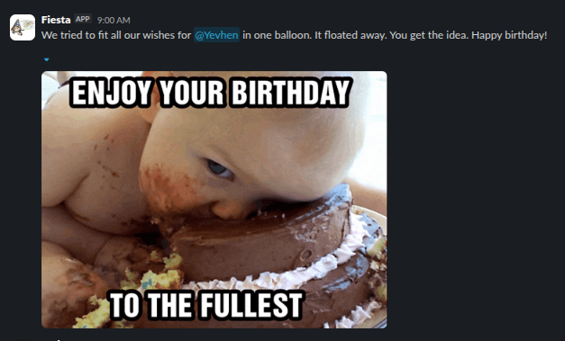

# Fiesta Bot

A Slack bot that never lets a team birthday slip by. It asks each member for their
birthday, DMs everyone else a few days ahead, and posts a congratulation in a channel on
the day.



## Features

- **Collects birthdays itself.** New members get a friendly DM with a *Set my birthday*
  button, plus a couple of gentle reminders if they don't answer. *Never ask me* stops it.
- **Heads-up DMs.** A few days before a birthday, everyone except the birthday person gets
  a private reminder, so nothing leaks into a channel early. Anyone can mute these.
- **Celebration post.** On the day, the bot mentions the birthday person in your channel
  with a randomly picked congratulation text.
- **Privacy built in.** The birth year is optional and never shown. Members can hide their
  birthday entirely, and deleting it removes it for good.
- **No public URL needed.** Runs in Socket Mode and dials out to Slack, so it works from
  any machine behind a firewall.
- **Small footprint.** One Python process and one SQLite file. Settings live in the
  database and change from the CLI without a redeploy.
- **Safe to restart.** Every scheduled message goes through a deduplicated outbox, so up
  to a week of missed days is caught up and nothing is sent twice.

## Setup

You need Python 3.14 and [uv](https://docs.astral.sh/uv/), or just Docker.

### 1. Create the Slack app

1. At [api.slack.com/apps](https://api.slack.com/apps) choose *Create New App → From an
   app manifest* and paste [`slack-app-manifest.yaml`](slack-app-manifest.yaml).
2. *Basic Information → App-Level Tokens*: generate one with the `connections:write`
   scope. That is `SLACK_APP_TOKEN`.
3. *Install to Workspace*, then copy the *Bot User OAuth Token*. That is
   `SLACK_BOT_TOKEN`.
4. Invite the bot to the channel where birthdays should be celebrated. It cannot post in a
   channel it is not in.

### 2. Configure

```bash
cp .env.example .env    # then paste in the two tokens
```

`.env` holds only secrets and paths. Everything else is set from the CLI once the bot is
running. See [Configuration](#configuration).

### 3. Run

**With uv:**

```bash
uv sync                 # create .venv and install everything
uv run fiesta migrate   # create the database
uv run fiesta run       # start the bot
```

**With Docker** (Linux hosts only, see [Deployment](#deployment)):

```bash
mkdir -p data && sudo chown 1000:1000 data
docker compose build
docker compose run --rm fiesta fiesta migrate
docker compose up -d
```

Then point the bot at your channel, using the channel ID from *channel details* in Slack.
Under Docker, prefix the commands in this README with `docker compose exec fiesta`
instead of `uv run`.

```bash
uv run fiesta settings set celebration_channel C0123456789
```

## Adding birthdays

Members add their own, so there is no list to maintain.

- **`/birthday`** opens a form in Slack to add, change or remove your birthday, hide it from
  the team, or mute the heads-up DMs about everybody else.
- **New joiners** are asked automatically a few days after they join
  (`ask_delay_days`), with up to two reminders.
- **An existing team** is introduced to the bot in one go. The daily roster sync would find
  everyone on its own, but it would greet them with the message meant for new joiners, so
  send the rollout message instead:

```bash
uv run fiesta sync                # pull the roster from Slack
uv run fiesta announce --dry-run  # check who would be messaged
uv run fiesta announce            # ask everyone who has no birthday yet
```

## Congratulation texts and GIFs

### Texts

On the day, the bot picks one enabled text at random and posts it. A fresh database has
none, and the post falls back to ":tada: Happy birthday, @name!" until you add some.

Each text must contain `{user}`, which becomes the mention. Slack formatting and emoji
codes work, so `*bold*` and `:cake:` render as usual.

```bash
uv run fiesta templates add "Happy birthday {user}! :tada:"
uv run fiesta templates list                           # IDs, and which are enabled
uv run fiesta templates edit 3 "Many happy returns, {user}!"
uv run fiesta templates edit 3 --disabled              # keep it, but don't use it
uv run fiesta templates remove 3
```

To add many at once, put one text per line in a file and feed it in:

```bash
xargs -d '\n' -n 1 uv run fiesta templates add < texts.txt
```

Each birthday gets its own post, so two birthdays on one day make two posts, each with
its own pick.

### GIFs

GIFs are off by default (see [Not yet](#not-yet)). The bot stores links, not files, so
each GIF needs a direct public URL to the image itself, ending in `.gif`. A link to a page
that shows the GIF won't work, because Slack fetches the URL when it posts.

```bash
uv run fiesta gifs add https://example.com/party.gif
uv run fiesta gifs list                                # fails, last used, retired ones in red
uv run fiesta gifs edit 2 --url https://example.com/new.gif   # a new URL resets its fails
uv run fiesta gifs edit 2 --disabled                  # keep it, but don't use it
uv run fiesta gifs remove 2
uv run fiesta settings set gif_provider db             # start using the pool
```

The bot picks from the GIFs used least recently, so the same one doesn't come up twice
running. A batch works the same
way as for texts:

```bash
xargs -d '\n' -n 1 uv run fiesta gifs add < gifs.txt
```

If Slack cannot fetch a GIF, the post goes out without it and the GIF gets a fail. After
3 fails it is retired from the rotation.

Under Docker, run the batch commands with `docker compose exec -T fiesta fiesta` in
place of `uv run fiesta`, and keep the file on the host.

## Configuration

Secrets and paths come from `.env`. Everything else lives in the database so it can be
changed without a redeploy:

| Setting | Default | Meaning |
|---|---|---|
| `celebration_channel` | — | channel ID for the birthday post |
| `post_time` | `10:00` | when the daily job runs (restart to apply) |
| `timezone` | `Europe/Kyiv` | the workspace timezone (restart to apply) |
| `ask_delay_days` | `3` | how long after joining before the first ask |
| `max_asks` | `3` | first ask plus reminders, then it gives up |
| `ask_interval_days` | `4` | gap between reminders |
| `upcoming_days_before` | `3` | how early the heads-up DMs go out |
| `gif_provider` | `none` | `none`, or `db` to use the curated GIF pool |
| `auto_send_enabled` | `true` | the bot delivers queued messages on its own |
| `celebration_enabled` | `true` | the birthday post in the channel |
| `upcoming_enabled` | `true` | the heads-up DMs before a birthday |
| `asks_enabled` | `true` | asking members for their birthday |

```bash
uv run fiesta settings list                    # every value, its default and meaning
uv run fiesta settings get post_time
uv run fiesta settings set post_time 09:30     # values are checked before they are stored
uv run fiesta settings reset post_time         # back to the default
```

The `*_enabled` switches take `true`/`false` and apply without a restart:

- `auto_send_enabled false` pauses delivery. Messages keep queuing; `fiesta send-due` still
  sends them by hand, which is handy when testing locally. Instant replies to a member's
  own click, like the confirmation after saving a birthday, still go out.
- `celebration_enabled false` skips the post, and those days count as handled. Switching
  it back on does not post the birthdays that were skipped.
- `upcoming_enabled false` skips the heads-up DMs the same way.
- `asks_enabled false` pauses asks and reminders. Nobody loses a turn; they resume where
  they stopped. `fiesta announce` is a deliberate command and still works.

The roster, with birthdays and who muted the heads-up DMs:

```bash
uv run fiesta users list                       # real people; --all adds bots and leavers
uv run fiesta users show U0123456789
uv run fiesta users mute --all-except U0123456789   # only this person gets heads-ups
uv run fiesta users unmute --all
```

`unmute --all` clears every mute, including ones members chose themselves.

## Deployment

```bash
IMAGE_TAG=$(git rev-parse --short HEAD) docker compose build
IMAGE_TAG=$(git rev-parse --short HEAD) docker compose run --rm fiesta fiesta migrate
IMAGE_TAG=$(git rev-parse --short HEAD) docker compose up -d
```

`IMAGE_TAG` is optional. When set, it tags the image and is reported to Sentry as the
release. Error reporting is off until `SENTRY_DSN` is set in `.env`.

The SQLite file is bind-mounted at `./data`. Back it up with a file copy and inspect it
with `sqlite3 data/fiesta.db`; neither needs the container running. The container is
non-root at UID 1000, so `./data` must be owned by UID 1000 on the host.

Linux hosts only: bind mounts under Docker Desktop on macOS and Windows go through a
FUSE layer that gets POSIX locking wrong, which can corrupt SQLite.

## How it works

Scheduled jobs never send to Slack directly. They write rows to an `outbox` table, and a
single drain loop delivers them. Each row carries a unique deduplication key, which means
every job is safe to run twice — after a restart, from the startup catch-up, or by hand.

To replay a day or flush the queue by hand:

```bash
uv run fiesta tick        # queue today's messages again; duplicates collide and vanish
uv run fiesta send-due    # deliver whatever is currently due
```

The outbox also keeps the tests fast: they check services by asserting on queued rows,
so almost nothing mocks Slack.

The only direct sends are the instant replies to a member's own click or form. The
startup catch-up replays at most the last 7 days; older birthdays are too stale to post.

## Not yet

GIFs are phase 2. The table, the selection rules and the message slot all exist; the
pool is empty and `gif_provider` is `none`, so celebrations post text only. Turning it
on takes no code change: add GIFs, then set `gif_provider` to `db`. See
[GIFs](#gifs).

## Development

Local development runs on the host; Docker is for production only. The
[`justfile`](justfile) holds the everyday commands, and `just` on its own lists them.

```bash
just check                    # format check, lint, types, tests — changes nothing
just fmt                      # format and apply the safe lint fixes
just test -k outbox           # extra args go to pytest
just cov                      # tests with a coverage report
just fiesta tick --date 2026-03-10   # queue the messages for a given day
```

The tests use in-memory SQLite and a fake Slack, so they need no services and no `.env`.

## License

[MIT](LICENSE)

---

Built by [Ezcloudlabs.com](https://ezcloudlabs.com).
